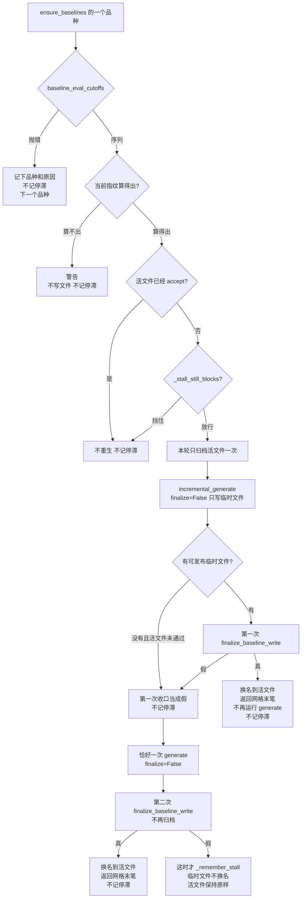
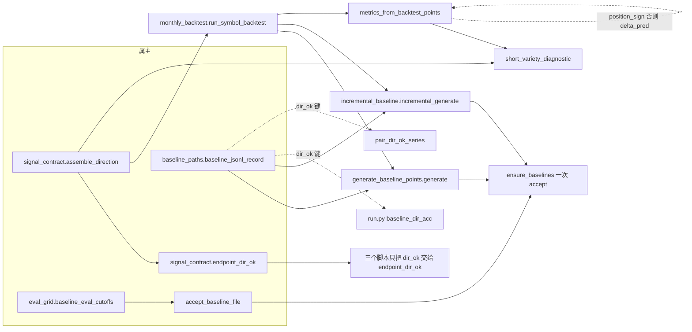

# 基线点的两套合同与验收后条件

| 项 | 值 |
|----|----|
| 作者 | （待填） |
| 日期 | 2026-11-03 |
| 状态 | Draft |
| 活仓 | `/home/abug/timesfm`（只读核对，本规格不改仓、不重启监督进程） |
| 取代关系 | 不改协议指纹，不发协议第五版。下文点合同取代 `docs/superpowers/specs/2026-09-14-prediction-quality-redesign-design.md` §3.1 里「`dir_ok = sign(delta_pred) == sign(delta_real)`」这句对基线 JSONL 的读法。确认窗口径仍以 `docs/superpowers/specs/2026-09-24-covariate-research-credibility-design.md` v9/v10 为准。 |

## Overview

审计报告 `docs/superpowers/reports/2026-11-03-baseline-audit-dir-ok-jd-report.md` 把两件事说成了数据损坏：一是 883/14138（6.2%）行的 `dir_ok` 与 `sign(delta_pred) == sign(delta_real)` 不一致；二是 `task_FM/config/baseline_points_jd_nocov.jsonl` 永远停在 3 行，并归因于「重生只看到当前主力合约、末端停在 2026-10-21」。两句都不成立。

第一件是两个问题共用了 `delta_pred` 这个名字。可交易方向由 `cascade/signal_contract.py` 的 `position_from_forecast` 定义为加权一小时预测减基准价的符号（CF-01 A）。方向对错 `dir_ok` 和门控用的方向准确率走端点：`scripts/monthly_backtest.py` 的 `endpoint_dir_ok`，以及 `cascade/evaluation_metrics.py` 的 `calc_prediction_quality` 自己用 `pred_end - base` 重算。经济指标 PF / EV / MaxDD 走 `metrics_from_backtest_points`，读的是存下来的 `delta_pred` 的符号。把存盘的 `delta_pred` 改成端点差，会在不改门控的情况下悄悄改掉经济指标。审计的方案 A 因此拒绝。

第二件是验收失败后的回滚目标不合格。`scripts/sup_evidence.py` 的 `_guard_confirm_from_ts_after_regen` 在全量重生之后，只要新文件缺了归档里任意一条 `>= confirm_from_ts` 的 cutoff 字符串，就 `shutil.copy2` 把归档盖回新文件，并且不检查归档自己是否还能通过「行数、协议指纹、当前网格」这些触发重生的条件。`jd` 现文件 3 行，启动走路径①，全量生成出当前网格的 588 行，守卫再把 3 行拷回去。`db/futures_jd.db` 的 `kline_1h` 只有连续序列 `JD_MAIN`（10080 行，2018-07-10 09:00 到 2026-11-02 14:00），不存在「只看到换月后的短合约」这回事。

本规格做两件事，并且把共享合同的调用方一起改掉：给端点方向和可交易增量各一个写入者；给每一次基线落盘同一个后条件。后条件比的是当前 `select_eval_indices` 网格，不是「新文件必须包含旧文件在确认窗里的 cutoff」。历史行保持有效。不为此重跑模型，不抬协议指纹，不移动 `confirm_from_ts`。

## Background & Motivation

### 审计叙事里哪些已经落地，本规格不动

报告第 2 节的 Laya 503、备份合并驱动、以及 `4c4d704` 在增量脚本里把续跑点拼回文件，都是背景。本规格不重新设计它们，也不把 `4c4d704` 的外部拼接当成最终合同。那次修补只说明：`run_symbol_backtest` 的文档写着 `resumed_points` 会合并进 `points`，实现却只在 `completed` 含有 `(symbol, cutoff)` 时才合并（`scripts/monthly_backtest.py` 406–410 行）。`incremental_generate` 传入 `resumed_points`、不传 `completed`，回测内部的合并不会发生。`4c4d704` 在回测外面又拼了一次。两个调用方、两种「谁负责合并」的想法还在。

### 问题 1：不是坏行，是两个合同共用一个字段名

`cascade/signal_contract.py` 模块文档第 3–13 行写明：唯一可交易方向是 `sign(weighted_1H_pred - base)`，经 `signal_weight` / `short_horizon`；端点 `sign(pred[T+24] - base)` 是遗留。`position_from_forecast`（36–106 行）在 `scheme is None` 时把 `delta_pred` 设成 `endpoint_delta`（63–82 行）；有方案时 `delta_pred = weighted - base`，同时仍返回单独的 `endpoint_delta` 和 `position_sign`（97–105 行）。

`config/prediction_scheme.py` 的 `SCHEMES` 现有 21 个键（`ao bu cf cj eg fg fu i jd jm lh m ma p rb sh sp sr ss ta ur`）。`y`、`px`、`oi` 不在表里。这三份基线对 `sign(delta_pred)` 与 `dir_ok` 的不一致计数为 0，是对照组：`get_scheme` 返回 `None`，加权退化为端点，两个问题碰巧问的是同一个数。不是这三份文件更干净。

`scripts/monthly_backtest.py` 里一次评估点同时做了两件事（497–530 行，点字典 562–567 行）：

- `delta_pred = position_from_forecast(...)["delta_pred"]`，有方案时是加权可交易增量。`position_sign` 参与 `pnl = position_sign * delta_real`（529–530 行）。
- `dir_ok = endpoint_dir_ok(pred[-1], real[-1], base)`（55–65 行、520 行）。同函数注释写明：`dir_ok` 用端点，与 `calc_prediction_quality` 一致；加权 `delta_pred` 只用于盈亏。

`calc_prediction_quality`（`cascade/evaluation_metrics.py` 399–432 行）不读 JSONL。它用调用方传入的端点价自己算 `delta_pred = p_end - base`，再算方向准确率。门控用的品种方向准确率走这条路径，或走下面这条更直接的路径。

`task_FM/evaluations/fm_eval/run.py` 109–112 行：`baseline_dir_acc = mean(stored dir_ok)`。它不读 `delta_pred`。自适应门槛是 `compute_effective_min`（`evaluator.py` 761–763 行）：`max(0.50, min(0.52, baseline_dir_acc))`。`cascade/statistical_tests.py` 的 `pair_dir_ok_series`（102–156 行）只按 cutoff 对齐 `dir_ok`。

因此审计第 9.6 节「p / cf / cj 超过 10% 会影响门控决策」对生产门控是错的。这三品种的翻转率（p 76/588、cf 70/637、cj 63/591）是「存盘 `dir_ok` ≠ (`sign(存盘 delta_pred) == sign(delta_real)`)」。`dir_ok` 已经是门控在用的端点位。改存盘 `delta_pred` 不会移动 `baseline_dir_acc`、自适应门槛或 Diebold-Mariano 配对。会移动的是 `metrics_from_backtest_points`（178–196 行）的 `dirs = np.sign(p["delta_pred"])`，也就是 PF / EV / MaxDD。方案 A 用端点覆盖 `delta_pred`，正好打在这条经济路径上，和 CF-01 A 相反。

真正的缺陷是投影和第三个写入者：

- `scripts/generate_baseline_points.py` 148–154 行和 `scripts/incremental_baseline.py` 117–123 行各写一份记录字面量，字段只有 `cutoff`、`dir_ok`、`delta_pred`、`delta_real`、`protocol_fingerprint`。内存里的点有 `pred_end`（566 行），`position_from_forecast` 还有 `endpoint_delta` 和 `position_sign`，两处落盘都丢掉了。后来的读者无法复核 `dir_ok`，就会把 `delta_pred` 「修」成端点。
- `scripts/short_variety_diagnostic.py` 310 行把 `dir_ok` 设成 `sign(delta_pred) == sign(delta_real)`（`delta_real == 0` 时还判真，和 `endpoint_dir_ok` 的零变动判假相反），332 行把同一个加权 `delta_pred` 写入点。174 行的 PF12 也直接取 `sign(delta_pred)`。这是第三套定义。诊断结果的 `summarize` 方向准确率仍从 `pred_end` 重算，所以汇总里的 `dir_acc` 和点上的 `dir_ok` 在这个脚本里可以互相矛盾。

`docs/superpowers/specs/2026-09-14-prediction-quality-redesign-design.md` 第 58 行仍写 `dir_ok = sign(delta_pred) == sign(delta_real)`，没有说这里的 delta 是端点。这句话和 CF-01 现在互相否定。每个量只能有一个属主，见下文 Proposed Design。

已落盘的 `dir_ok` 就是门控在用的端点位。修合同不等于重写这 21 个品种的基线，也不等于重跑 TimesFM。

### 问题 2：守卫把一份没通过验收的文件拷了回去

当前活文件 `task_FM/config/baseline_points_jd_nocov.jsonl` 为 3 行，cutoff 全是 2026-10-21 的 `10:00:00`、`12:00:00`、`15:00:00`，协议指纹 `f02b2a433fd572eab341c7e4ad2f394168f5a02ddb6d5739dcebbdce49db4ae5`（与 `compute_protocol_fingerprint` 的现行 v4 输入一致）。这三笔收盘时刻正好是 `JD_MAIN` 日盘开盘 `09:00, 10:00, 11:00, 13:00, 14:00` 上、步长为 2 的那一相：开盘加一小时得到 `10:00, 12:00, 15:00`。它是某一相的尾部碎片，不是随机坏字节。

同目录仍在的 `baseline_points_jd_nocov.archive_20260929T1500.jsonl` 为 588 行，首笔 `2025-10-16 10:00:00`，末笔 `2026-09-29 15:00:00`，指纹相同。`archive_20261008T1000.jsonl` 只有 1 行：`2026-10-08 10:00:00`。`archive_20261021T1500.jsonl` 与活文件同为那 3 行。

`DataStore.get_main_contract_1h`（`data/data_store.py` 549–568 行）优先 `{SYMBOL}_MAIN`。`kline_1h` 里 `jd` 只有 `JD_MAIN`。审计「重生只看见当前主力、所以末端停在 2026-10-21」不成立。监督日志 `data/cache/supervisor.out` 反复出现生成成功紧接着回滚，最近一次是：

```
[Done] 品种 JD 基线生成完成: n=588, dir_acc=0.481, endpoint_mape=3.86
[ERROR] ensure_baselines: jd 重锚删除了 >= 2026-10-03 00:00:00 的 基线 cutoff ['2026-10-21 10:00:00', '2026-10-21 12:00:00', '2026-10-21 15:00:00'] → 已从归档恢复旧档（v9 修订②守卫）
```

更早的循环曾因为新 588 行里没有 `2026-10-08 10:00:00` 而把 1 行归档拷回去（日志约 151616、156924 行）。那是当时那一相的网格，不是今天的网格。

按今天的 `JD_MAIN`、`CONTEXT_BARS=480`、`HORIZON=24`、`STEP=2`、`EVAL_WINDOW_BARS=1200`（`config/backtest_config.py`）重算 `select_eval_indices`（`eval_start_ts is None`）：`total=10080`，`left=8880`（开盘 `2025-11-05 09:00`），`right=10055`（开盘 `2026-10-27 09:00`），588 个下标，收盘从 `2025-11-05 10:00:00` 到 `2026-10-26 15:00:00`。这条网格包含 `2026-10-08 10:00:00`，不包含三笔 2026-10-21 疤痕。当天网格上的收盘是 `11:00` 和 `14:00`。开盘 `2026-10-21 09:00` 的下标是 10035，相对 `left` 的偏移是 1155，不是步长的整数倍，不会被选中。`STEP` 是下标步长。多一根或少一根 bar，后面每一个钟点的相位都会翻。疤痕时间戳和一份正确的 588 点文件不是超集关系。九月那份 588 行（末笔在确认窗之前）也不是今天的网格：守卫当年看到 `old_kept` 为空，于是返回真，疤痕才被允许替换它（`scripts/sup_evidence.py` 1410–1412 行：旧档没有 `>= confirm_from_ts` 的点就直接通过）。

`ensure_baselines`（1503 行起）今天有三条路径。这是现状，不是本规格的启动规则。启动规则在「后条件与回滚」里收成一次 `accept_baseline_file`，这三条不再各自决定要不要写：

| 路径 | 条件 | 今天的调用 | 守卫 |
|------|------|------------|------|
| ① | 指标缺失，或 JSONL 有效行数 `< 100`（1558–1560 行） | `_regen_baseline_with_archive` → `generate_baseline_points.generate` | 会调用 |
| ② | 协议指纹不符（1562–1609 行落到全量） | 同上 | 会调用 |
| ③ | 末端陈旧（`_baseline_reanchor_reason`，1342 行起） | `_incremental_or_regen`（1425–1446 行） | 增量成功就返回，不调用守卫 |

`_regen_baseline_with_archive`（1449–1467 行）总是调用守卫，然后忽略返回值，仍 `_read_last_cutoff`。守卫（1378–1422 行）只在该品种的 `task_FM/config/preregistry.jsonl` 里有 `confirm_from_ts` 时做事。今天只有 `jd`（`n_confirm_required=1199`）和 `sr`（`n_confirm_required=986`），两者都是 `confirm_from_ts=2026-10-03 00:00:00`。没有预注册的品种直接返回真。`jd` 只有 3 行，每次启动走路径①：生成 588，守卫把 3 行拷回。这就是死循环。守卫按预注册键工作，不按品种名 `jd` 写死；以后新登记的品种会走同一条路径。

`sr` 不是「还没被这个守卫碰过」。`data/cache/supervisor.out` 第 20706–20707 行和第 151989–151990 行都是：全量写出 `n=588` 之后，立刻因为新文件缺少 `2026-10-08 10:00:00` 而从归档恢复，并记停滞 0.0 天。更晚的第 166683–166697 行在末端落后 604 小时后走增量，日志写明「588 旧点 + 49 新点 = 637」，`new_cutoff=2026-10-28 10:00:00`。今天的活文件就是这次拼接的结果：637 行，`2026-01-20 15:00:00` 至 `2026-10-28 10:00:00`，指纹前缀 `f02b2a433fd572ea`。按今天的 `SR_MAIN`（10108 行，`2020-10-30 09:00` 至 `2026-11-02 14:00`）重算网格是 588 个收盘时刻，`2026-02-09 15:00:00` 至 `2026-10-28 10:00:00`。活文件包含这 588 个时刻，另外多出 49 个更早的 cutoff，序列不相等。它不是一份没被守卫动过的当前网格，也不能因为「行数够、末笔新」就当恢复目标。下一次按新后条件落盘时，这 49 个网格外的行要丢掉。不要手改 `sr`，也不要为此新增预注册行。

v9/v10（`docs/superpowers/specs/2026-09-24-covariate-research-credibility-design.md` 第 9–10 行、437–496 行）不要求两次评估的 cutoff 集合相同。`pairing_valid` 是共同样本数量加上缺失是否可接受。`dm_status` 包含 `set_mismatch_ok`。`confirm_from_ts` 是登记时锁死的时间边界；确认集是该边界之后的预定 cutoff 序列，再与两边都有的点取交集。缺的点是缺失，不是删掉一份合格探索基线的理由。守卫注释写「保 v9 修订②」，代码做的却是更严的「旧 cutoff 字符串必须被新文件包含」，而且施加在探索用的无协变量基线上，不是施加在确认样本上。这个错位是根因。

不接受的修法：只为 `jd` 开特例；手工删掉 3 行然后指望下次不会再长出来；只加 `if n < 100: 不要回滚`。最后一种仍然把「超集」当成窗口的身份，只是给当前这具尸体开了后门。`sr` 的 637 行相对今天的网格正是超集（多 49 个旧点），行数远大于 100，这条后门不会动它，后条件的序列相等才会丢掉那 49 行。

把 `STEP` 改成按钟点对齐，会改变哪些 cutoff 存在，使已有裁决不可比，并迫使协议指纹输入变化和全量基线重生。那是另一份规格。本规格拒绝它，也因此拒绝「用历史 cutoff 字符串当作滑动窗口的身份」。

## Goals & Non-Goals

### Goals

1. 每个量一个属主。`dir_ok` 只表示端点方向是否正确，只能由 `endpoint_dir_ok` 产生（`calc_prediction_quality` 继续自己从端点价重算方向准确率，不改公式）。可交易方向只来自 `position_from_forecast` 的 `position_sign` / 加权 `delta_pred`。
2. `monthly_backtest`、`generate_baseline_points`、`incremental_baseline`、`short_variety_diagnostic` 共用一个方向装配函数和一份基线记录投影。禁止第二份记录字面量。另外三个脚本并不写探索基线，但它们把结果字段命名为 `dir_ok`，且零变动判真：`scripts/batch_backtest.py`、`scripts/backtest_vol_gating_fullchain.py`、`scripts/validate_context_length.py`。字段名 `dir_ok` 只有一条规则，见下文，不允许实现者改选「改名后保留旧比较」。
3. 已写行的 JSONL 键 `delta_pred` 继续表示加权可交易增量（无方案时它本来就等于端点差）。新写的行追加 `endpoint_delta` 和 `position_sign`，使 `dir_ok` 可复核，经济指标不再从「读者也当成预测增量」的字段推断持仓。
4. 每一次基线落盘（全量、增量、以后的调用方）使用同一个后条件：行集等于该品种在当前协议下的 `select_eval_indices` 网格（含与 `run_symbol_backtest` 相同的日线充足性过滤），外加单调、无重复、每行协议指纹等于当前指纹。通过就保留新文件，即使旧 cutoff 字符串不见了。
5. 回滚只允许落到本身通过同一后条件的归档。3 行或 1 行不能成为恢复目标。未通过后条件的字节不得换名盖上活文件；活文件保持换名之前的那一份。没有任何通过的归档时也不要把失败的新内容留下当活文件。禁止把触发重生的那份不合格文件拷回去。
6. 确认窗的关切保留为缺失报告，不再是超集回滚。`jd` 与 `sr` 以及以后任何带 `confirm_from_ts` 的品种走同一条代码，不写品种名特例。
7. `run_symbol_backtest` 在 `resumed_points` 含有该 cutoff 时必须合并，不得再要求 `completed` 也含有它。`incremental_generate` 不再在回测外拼接，也不再把 `last_cutoff + 2h` 当成 `eval_start_ts`。

### Non-Goals

- 不重做 Laya 预热、`LAYA_SKIP_AUTH`、备份机 `merge=protected-ours`。
- 不改自适应门槛公式，不改 `compute_protocol_fingerprint` 的输入，不引入协议第五版，不因 JSONL 多了字段就抬指纹。`compute_sample_fingerprint` 仍只哈希 cutoff。
- 不移动 `confirm_from_ts`，不新增预注册行，不改锁定的确认样本长度 1199 / 986。
- 不重启监督进程，不运行 `scripts/restart_three_loop_clean.sh`。把本规格应用到活的 `jd` 文件是单独的运维步骤，规格描述它，不执行它。
- 不改 `.venv` 里的 Praxist，不把模型权重加载当作 `dir_ok` 的修复。
- 不改 CF-01。`position_from_forecast` 仍是可交易方向。Copilot 仍走加权。
- 不把 `STEP` 改成钟点步长，不把 `_valid_n_for_symbol` 的右边界改到与网格一致（见 Risks：那是收割计数，不是本规格的验收网格）。
- 不手工删除活的 3 行文件来「先让循环停下来」。
- 不把 `scripts/batch_backtest.py`、`scripts/backtest_vol_gating_fullchain.py`、`scripts/validate_context_length.py` 列成例外。它们不写探索基线，但只要字段仍叫 `dir_ok`，就适用同一条端点规则，放在 PR1。不允许改名保留零变动判真，也不允许只改其中一两个。

## Proposed Design

### 量的属主

| 量 | 问的问题 | 唯一计算处 | 谁可以读 | 谁不可以拿它做别的事 |
|----|----------|------------|----------|----------------------|
| `endpoint_delta` | 端点价减基准价 | `position_from_forecast` 已返回该键（61、80、104 行） | 新 JSONL；`dir_ok` 的复核 | 不得当作持仓符号 |
| `dir_ok` | 端点方向是否与真实端点同号；真实变动绝对值 `< 1e-8` 为假 | `endpoint_dir_ok` | 基线方向准确率的平均、`pair_dir_ok_series`、`point_dir_ok_list` | 不得由 `sign(delta_pred)` 赋值。无方案时两者数值碰巧相同，仍然必须调用 `endpoint_dir_ok` |
| `delta_pred` | 加权可交易增量；无方案时等于端点差 | `position_from_forecast` 的 `delta_pred` | 旧读者在没有 `position_sign` 时的后备；幅度类读者（例如 `neutral_ab_report.py` 里对绝对值的使用） | 新代码不得再假设「它的符号就是 `dir_ok` 的预测侧」 |
| `position_sign` | 可交易方向，`{-1, 0, +1}` | `position_from_forecast` | `metrics_from_backtest_points`、盈亏、诊断脚本的 PF12 | 不得写入后被端点符号覆盖 |
| `delta_real` | 基线文件里是未截断的 `real[-1] - base` | 回测点 | 与 `endpoint_delta` 一起复核 `dir_ok`；经济收益 | `clip_gap` 不是基线写入路径。基线调用不传 `clip_gap`。不要为了复核去改截断实验里点字典的 `delta_real` |
| 方向准确率（门控） | 端点，零变动从分母剔除的那一套仍由 `calc_prediction_quality` 负责 | 不改 | `gate` / `compute_effective_min` | 基线侧门槛的输入继续是 `mean(stored dir_ok)`，不要改成 `calc_prediction_quality` 的剔除口径来「对齐」 |
| 探索基线的 cutoff 集合 | 当前数据上、当前协议参数下的评估网格 | 下面的 `baseline_eval_cutoffs` | 后条件 | 不是确认集，也不是上一份文件的超集 |
| 确认集 | `cutoff >= confirm_from_ts` 的预定序列 ∩ 两边都有的点 | 既有 Diebold-Mariano 配对 | 缺失报告 | 缺失不触发探索基线回滚 |

`endpoint_dir_ok` 今天放在 `scripts/monthly_backtest.py` 55–65 行，而该模块顶部导入 `torch`。装配函数和后条件都不能为此再拉起一份只为了纯函数的导入链。把 `endpoint_dir_ok` 移到 `cascade/signal_contract.py`（该文件只有 numpy），`monthly_backtest.py` 再导出同名函数，现有 `from monthly_backtest import endpoint_dir_ok`（`tests/test_monthly_backtest_quality.py` 214 行）保持可用。函数体不改：真实端点变动绝对值小于 `1e-8` 返回假，否则比较两端点相对基准价的符号。

### 方向装配

在 `cascade/signal_contract.py` 增加 `assemble_direction(point_forecast, base_price, real_end, scheme, daily_slope=None) -> dict`。它只做合同，不碰数据库，不碰模型：

```python
def assemble_direction(point_forecast, base_price, real_end, scheme, daily_slope=None):
    sig = position_from_forecast(
        point_forecast, base_price, scheme=scheme, daily_slope=daily_slope,
    )
    endpoint_delta = float(sig["endpoint_delta"])
    real_end_f = float(real_end)
    base = float(base_price)
    return {
        "delta_pred": float(sig["delta_pred"]),
        "position_sign": float(sig["position_sign"]),
        "endpoint_delta": endpoint_delta,
        "dir_ok": endpoint_dir_ok(base + endpoint_delta, real_end_f, base),
    }
```

`dir_ok` 用 `base + endpoint_delta` 而不是再写一遍 `pred[-1] - base`，这样端点差的唯一来源是 `position_from_forecast`。无方案时 `delta_pred == endpoint_delta`，`dir_ok` 与加权符号一致，这是对照组，不是第二套公式。

`scripts/monthly_backtest.py` 497–520 行改为调用 `assemble_direction`。点字典（562 行起）必须带上 `endpoint_delta` 和 `position_sign`。`pnl` 继续用 `position_sign * delta_real`（`clip_gap` 仍只影响点里用于经济指标的 `delta_real`，不参与 `dir_ok`）。禁止在该函数里保留 `dir_ok = endpoint_dir_ok(...)` 以外的方向赋值；连这行也不留，只留装配函数调用。

`scripts/short_variety_diagnostic.py` 的 `run_diagnostic_backtest`（295–340 行）同样改为 `assemble_direction`。点的 `cutoff` 必须是完整收盘时间戳（该函数 264 行已经算了 `cutoff`，329 行却把只有日期的 `dt` 写进点）。诊断可以另留 `cutoff_date` 给展示。诊断的续跑主键仍是 `(symbol, idx)`（253–258 行、449 行），它不是探索基线文件，不必改成 cutoff 主键。PF12（167–179 行）改为使用下面的 `tradable_sign`，不得再写 `np.sign(p["delta_pred"])`。

### 其余三个脚本里的 `dir_ok`

这条已经定死。它不是开放问题，也不能改选成「局部变量改名，零变动仍判真，然后写进 Non-Goals」。三个脚本都不写探索基线。只要结果字段还叫 `dir_ok`，这三个脚本就直接调用 `endpoint_dir_ok`。不要改走 `assemble_direction`：那会把方案权重引进它们的 `delta_pred`。回测和诊断才走 `assemble_direction`，因为它们本来就要同时产出加权增量。真实端点变动绝对值小于 `1e-8` 时该字段为假。三个都放进 PR1。只改其中一个或两个，规格视为没做完。

经济口径不要跟着这行一起改。这三个脚本的 `delta_pred`、盈亏和持仓符号保持它们今天的算法，只有 `dir_ok` 这一字段换属主。

- `scripts/batch_backtest.py` 60–62 行已经是端点：`delta_pred = pred[-1] - base`。只把 62 行换成 `endpoint_dir_ok(float(pred[-1]), float(real[-1]), float(base))`。不要把 `position_from_forecast` 或方案权重引进这个脚本的 `delta_pred` 或盈亏。文件头写明它是 CF-20 A 废弃的遗留扫描，固化走 `monthly_backtest.py`。85–86 行的 `dir12_ok` 是另一个字段，本规格不改公式、不改名。
- `scripts/validate_context_length.py` 79–81 行同样已经是端点差。只替换 `dir_ok` 那一行，调用与上一款相同。`position_sign = np.sign(delta_pred)` 和后面的 `pnl` 仍是端点，这是上下文长度扫描，不要改成加权。
- `scripts/backtest_vol_gating_fullchain.py` 的 `_point_from_pred`（94–146 行）先用 `position_from_forecast` 得到加权 `delta_pred`。否决分支（104–108 行）仍把 `delta_pred` 压成 0，注释「Neutral override always flats economic position」保留。`position_sign = sign(delta_pred)` 和 `pnl` 仍读压平之后的增量，空仓不扣滑点。`dir_ok` 必须单独写成 `endpoint_dir_ok(float(pred[-1]), float(real[-1]), float(base))`，不得读取压平后的 `delta_pred` 的符号，也不得在否决时改成假或真。仓内这个文件只有 108 行给 `dir_ok` 赋值、135 行把它放进点，没有第二个读者。不要再留一个也叫 `dir_ok` 的位去保存旧比较。同函数里的 `dir12_ok` 本规格不动。

`_CHECKPOINT_POINT_KEYS`（`monthly_backtest.py` 108–114 行）追加 `endpoint_delta` 和 `position_sign`。旧检查点没有这两键时，续跑仍合并其余字段；投影函数对缺键的行省略这两键，不填 `null`，也不要为了补键去重跑模型。

### 基线记录投影：只许一份

在 `cascade/baseline_paths.py`（已有 `baseline_filename`，8–13 行）增加 `baseline_jsonl_record(point, protocol_fingerprint) -> dict`：

- 必写：`cutoff`（必须能被 `%Y-%m-%d %H:%M:%S` 解析）、`dir_ok`（bool）、`delta_pred`（float）、`delta_real`（float）、`protocol_fingerprint`。
- 点里有 `endpoint_delta` 就写入 float；有 `position_sign` 就写入 float。没有就省略键。禁止把缺失写成 `0`，否则旧行会被假装成「端点差为零」。
- 不写 `pred_end` / `base`。复核公式不需要它们：`endpoint_dir_ok(endpoint_delta, delta_real, 0.0)` 与 `endpoint_dir_ok(base + endpoint_delta, base + delta_real, base)` 相同，因为函数内部减的是同一个基准价。基线行的 `delta_real` 是未截断端点真实变动，这条等式成立。

`scripts/generate_baseline_points.py` 148–154 行和 `scripts/incremental_baseline.py` 117–123 行的字典字面量删除，改为调用 `baseline_jsonl_record`。两处模块文档里「JSONL 只写四个字段」的句子（`generate_baseline_points.py` 7–14 行）改成上述键集。`tests/test_generate_baseline_points.py` 57–60 行现在断言键集恰好是旧五元组；该断言要改成「必有旧五元组，且当点上带了新字段时文件里也有」。这个测试用的是同一 cutoff 重复 120 次的假点，不应当被迫去打真实数据库。它要 monkeypatch 掉后条件（见下），网格测试另写。

### 经济指标读哪一个符号

`cascade/evaluation_metrics.py` 增加 `tradable_sign(point) -> float`：

1. 点里有 `position_sign` 且不是 `None`：返回 `float(position_sign)`。
2. 否则返回 `float(np.sign(point["delta_pred"]))`。

`metrics_from_backtest_points` 192 行的 `np.sign(p["delta_pred"])` 改为 `tradable_sign(p)`。

已落盘的基线没有 `position_sign`，后备就是今天的 `sign(delta_pred)`，而那些行的 `delta_pred` 已经是加权增量。PF / EV / MaxDD 的数值不变。新行两者都在，且 `position_sign == sign(delta_pred)`（零增量时两者都是 0）。即便以后有人把 `delta_pred` 改成端点差，只要 `position_sign` 还在，经济指标也不跟着翻。这是拒绝方案 A 的结构原因，不是多写一个字段。

诊断脚本的 PF12 使用同一个 `tradable_sign`。`cascade/neutral_ab_report.py` 和 `cascade/vol_gating_replay.py` 若只看 `delta_pred` 的绝对值或把它当路径输入，本规格不改它们的读法：键的含义没有从「加权增量」变成「端点差」。不要顺手把这些读者改成端点。

### 网格：一个函数

新增 `cascade/eval_grid.py`（只依赖 pandas、`config.backtest_config`、`data.data_store`，不导入 torch，不导入 `monthly_backtest`）。把下面三件从 `scripts/monthly_backtest.py` 移进来，原模块改为调用它们，避免两套右边界：

- `_bar_dt`、`_close_ts`、`select_eval_indices`（现 256–292 行）。右边界保持 `total - HORIZON - 1`。禁止抄 `scripts/sup_evidence.py` 1035–1058 行的 `_valid_n_for_symbol`：它的循环是 `range(left, len(h1) - HORIZON + 1, STEP)`，停点比 `select_eval_indices` 多一个可能下标。注释写着「复刻 run_symbol_backtest」，实际右边界不一致。收割（`scripts/sup_harvest.py` 707 行、`scripts/sup_loops.py` 134 行）用的是这个计数。本规格不改它，验收也不许调用它。
- 日线充足性过滤，与 `run_symbol_backtest` 370–384 行逐字同一条件：`min_daily_required = max(CONTEXT_DAYS - HORIZON_DAYS, 100)`，用 `bisect` 比较日期前缀。抽成 `filter_by_daily_sufficiency(indices, hourly_dt, daily_df)`，回测循环改为调用它。
- `baseline_eval_cutoffs(symbol) -> list[str]`：`DataStore(symbol).get_main_contract_1h(limit=99999)`，不传 `eval_end_ts`、不传 `eval_start_ts`、不传 `max_points`。先 `select_eval_indices`，再日线过滤，再对每个下标做 `_close_ts`。返回的列表就是全量 `generate` 在模型全部成功时应该写下的 cutoff 序列。读库失败或序列为空时抛错，不得返回空列表冒充「网格就是空的、空文件可以通过」。

今天的 `jd` 在日线过滤前后都是 588。规格仍要求过滤与回测同源，以免短日线品种的后条件比回测多几个点，每次落盘都被拒。

`incremental_generate` 今天用 `last_cutoff + timedelta(hours=2)` 当作 `eval_start_ts`（`scripts/incremental_baseline.py` 50–56、83 行）。`select_eval_indices` 在有 `eval_start_ts` 时从「第一根收盘时间不早于该时刻」重新起跳（274–286 行），步长相位不再等于全窗口的 `left`。钟点加两小时不是下标步长。增量路径禁止再传 `eval_start_ts`。

### 后条件与回滚



图下这条与第 6 步、`_incremental_or_regen`、Key Decisions 第 9 条、Rollout 第 3 步是同一句，不许另写结尾：`incremental_generate` 返回后：已有可发布临时文件就调用 `finalize_baseline_write`。第一次收口为真就换名、返回网格末笔、不再运行 `generate`。没有可发布临时文件（包括任一评估点带 `error`，或换名前失败），或临时文件未通过，这是第一次接受失败，不是提前结束；没有临时文件且活文件尚未通过时，把第一次收口当成假。只有第一次收口为假，才恰好运行一次 `generate(..., finalize=False)` 并第二次调用 `finalize_baseline_write`。只有第二次收口为假才 `_remember_stall`。第一次为真不记停滞。读网格或写入抛出的异常不是这个 `None`：留在品种循环的 `except` 里记日志；读网格失败不记停滞、不启动全量；写入中途抛出则记停滞，并且不再启动另一次全量。

`cascade/eval_grid.py` 或 `scripts/sup_evidence.py` 提供纯函数 `accept_baseline_file(path, expected_cutoffs, current_fingerprint) -> tuple[bool, str]`。`expected_cutoffs` 由调用方用 `baseline_eval_cutoffs` 算好，便于测试注入，不在断言函数里偷偷打开生产库。通过当且仅当：

1. 文件可逐行解析为 JSON 对象。
2. 每行有 `cutoff`、`dir_ok`、`delta_pred`、`delta_real`、`protocol_fingerprint`。不要求旧行有 `endpoint_delta` / `position_sign`。新写的行有这些键，但不作为「文件能否替换活文件」的条件，否则增量复用旧行会被强迫全量重跑模型。
3. 调用方传入的 `current_fingerprint` 非空，且每行 `protocol_fingerprint` 等于它。传入空指纹时后条件为假。启动循环另有一条更早的短路，见下，不把「指纹函数返回空」当成一次失败的写入。
4. `cutoff` 严格递增、无重复。
5. `cutoff` 序列与 `expected_cutoffs` 逐项相等。不是超集，不是子集，不是「行数 ≥ 100」。行数等于网格长度是第 5 条的推论。任一评估点带 `error` 因而少写的文件，是子集，通不过。

### 启动只问一次后条件

`ensure_baselines` 对每个品种按下面的顺序做，不再先走今天的三条路径。行数小于 100、指纹不符、末端落在 168 小时以内、确认窗有缺口，都不再单独决定要不要写。活文件不等于 `baseline_eval_cutoffs` 的返回值，就是要写；等于，就什么都不写。`_baseline_reanchor_reason` 留在原地给 `tests/test_baseline_reanchor.py` 里 `test_reanchor_reason_*` 用，`ensure_baselines` 不再调用它。`baseline_metrics.json` 缺条目，也不再单独触发 `generate`：门控读的是点文件里的 `dir_ok`。点文件已经通过后条件时，不要为了填指标再加载模型。点文件不存在时后条件为假，冷启动仍会写一次。`tests/test_ensure_baselines_fingerprint.py` 的 `test_no_metrics_entry_regenerates` 夹具没有点文件，所以仍会进入写入；不要把它改成「有一份已经等于网格的文件时也重生」。

每个品种包在 `try` / `except` 里。`scripts/sup_evidence.py` 1536–1611 行今天只有 `try` / `finally`，异常会离开函数，后面的品种本轮不再检查。`scripts/sup_loops.py` 1079–1083 行会接住整个 pre-flight 并打印 `[ERROR] ensure_baselines pre-flight failed`，然后进程继续。那个外层 `except` 不是隔离边界，不要靠它。网格函数本身仍然抛错：读库失败或序列为空不得返回空列表，空文件不能因此通过。

1. `expected = baseline_eval_cutoffs(symbol)`。这里抛错：日志写品种和异常，`continue`。不调用 `finalize_baseline_write`，不调用 `_remember_stall`。一次读库失败不得把品种锁到数据末端变新为止。
2. `fp = _current_protocol_fingerprint()`。返回空：打警告，`continue`。不重生，不删文件，不记停滞。这是 `test_fingerprint_check_skipped_when_current_unavailable` 要保住的行为。
3. `accept_baseline_file(points_path, expected, fp)` 为真：不重生，不记停滞。确认窗缺失警告不在每次启动对旧归档重放，只在下面一次成功的 `finalize_baseline_write` 里打。
4. 为假，且 `_stall_still_blocks` 为真：跳过，不加载模型。断路器仍是 `data/cache/baseline_regen_breaker.json` 里记下的数据末端；当前末端不能证明严格更晚就不放行。不新做第二套断路器。
5. 为假且断路器放行：调用 `_archive_baseline_before_regen` 一次，然后进入第 6 步。降级不再归档，也不是把这一步的归档和 `incremental_generate` 再跑一遍。
6. `_incremental_or_regen` 只按这一句做：`incremental_generate` 返回后：已有可发布临时文件就调用 `finalize_baseline_write`。第一次收口为真就换名、返回网格末笔、不再运行 `generate`。没有可发布临时文件（包括任一评估点带 `error`，或换名前失败），或临时文件未通过，这是第一次接受失败，不是提前结束；没有临时文件且活文件尚未通过时，把第一次收口当成假。只有第一次收口为假，才恰好运行一次 `generate(..., finalize=False)` 并第二次调用 `finalize_baseline_write`。只有第二次收口为假才 `_remember_stall`。第一次为真不记停滞。读网格或写入抛出的异常不是这个 `None`：留在品种循环的 `except` 里记日志；读网格失败不记停滞、不启动全量；写入中途抛出则记停滞，并且不再启动另一次全量。第一次收口为真，或第二次收口为真，都把网格末笔返回给 `ensure_baselines`。第一次收口为真不得进入 `generate`。第二次为假才返回 `None`，调用方只在这个 `None` 上 `_remember_stall(sym, root, sup_state._latest_data_dt(sym))`。不得把临时文件或未通过文件的最后一笔 cutoff 交给 `_remember_stall`。今天 1603–1604 行「推进不足 7 天就 `_remember_stall`」从这条启动路径删除。1584 行的 `_stall_still_blocks` 仍在，挡住的是上次第二次收口失败，不是末端推进太慢。
7. 第 6 步最后一句就是异常路径，不另写结尾。`incremental_generate` 自己把错误收成 `None` 且没有临时文件，仍是第一次收口为假，才跑那一次全量。第一次收口为真不得进入 `generate`。`_regen_baseline_with_archive` 1460–1465 行若把这次全量 `generate` 的异常收成 `None`，那是第二次收口失败，把 `None` 交给 `ensure_baselines` 去记停滞，不得再启动一次全量。没接住、抛到品种循环的，同样记停滞并且不再启动另一次全量。外层 pre-flight 的 `except` 仍然不是隔离边界。

今天的 `jd` 活文件是 3 行，不等于 588 点网格，断路器未挡住时会进入第 5 步。三笔 `2026-10-21` 的 cutoff 不在今天的网格上，增量几乎没有可复用行。没有可发布临时文件，或临时文件未通过，第一次收口为假，都只进入第 6 步那一次 `generate(..., finalize=False)`，不是再走一遍归档和增量。`sr` 的 637 行里含有今天网格的全部 588 个 cutoff，且指纹前缀是现行 `f02b2a433fd572ea`。增量只复用网格上的行，模型调用次数可以为零；多出的 49 行不进入临时文件。这份临时文件若通过，第一次收口为真，换名、返回网格末笔，不再运行 `generate`。

### 唯一的收口

`finalize_baseline_write(symbol, points_path, root, archive_path) -> bool` 放在 `scripts/sup_evidence.py`。它是唯一把新字节换名到活文件上的函数，也是唯一允许 `copy2` 回滚的函数。参数表不再增加 `expected_cutoffs`。网格只通过它内部调用的 `baseline_eval_cutoffs` 取得。测试要换网格就 monkeypatch 这个函数，不要给生产函数加注入参数。

删除 `_guard_confirm_from_ts_after_regen`。不要留一个仍做超集 `copy2` 的包装。生产调用今天只有 1466 行，但 `scripts/praxist_supervisor.py` 的 `_HOMES`（92 行）把这个名字指到 `sup_evidence`，`__getattr__`（133–137 行）再导出。`tests/test_baseline_reanchor.py` 89、102、113、127 行经 `import praxist_supervisor as sup` 直接调用它。删函数时删掉 `_HOMES` 里的那一条。导出消失之后，这四条测试不能再调用旧名字。

候选字节在活文件旁边的临时文件 `.{baseline_filename}.tmp`，也就是 `generate_baseline_points.py` 131–134 行已经使用的路径。`finalize=False` 不得把这个临时文件 `rename` 成活文件。

`generate` 与 `incremental_generate` 增加参数 `finalize: bool = True`。

`finalize=False` 时脚本不接受、不回滚、不归档：

- `result["points"]` 里任何一个点含有键 `error`：不要写可发布的临时文件；已经写下的部分删掉；日志写错误点数，并最多列出几条 cutoff。返回 `None`。这是写入失败，不是一份可以向上交的末端。今天 `generate_baseline_points.py` 138–139 行 `if "error" in pt: continue` 然后仍会 `rename`，必须删掉这种跳过。
- 没有错误点：用 `baseline_jsonl_record` 写临时文件，不换名。返回临时文件最后一笔 cutoff。写本身失败（异常、零行）返回 `None`。
- 不调用 `accept_baseline_file`，不调用 `finalize_baseline_write`。

`finalize=True` 是命令行默认。脚本在写临时文件之前自己归档活文件一次（监督不会在外面再归档），然后调用 `finalize_baseline_write`。返回假就向命令行返回 `None`。返回真就返回已经换上的活文件的最后一笔 cutoff。监督调用时始终传 `finalize=False`，归档由 `ensure_baselines` 在本轮第一次写入之前做一次。两层都归档，或两层都接受，都是错的。

`finalize_baseline_write` 的步骤：

1. `expected = baseline_eval_cutoffs(symbol)`，`fp = _current_protocol_fingerprint()`。网格或指纹在这里失败：不换名，返回假。启动循环在进入写入之前已经处理过这两种失败，这里是收口函数自己的底线。
2. 临时文件存在则对临时文件做 `accept_baseline_file`。不存在则没有新字节，活文件保持原样，按第 4 步返回假（活文件若已经通过，返回真，这只可能发生在命令行重复收口；监督路径在活文件已通过时不会调用它）。
3. 临时文件通过：把它 `rename` 成 `points_path`。若预注册里 `min(confirm_from_ts)` 存在，且 `archive_path` 里有 `>=` 该边界、但不在 `expected` 里的 cutoff，打警告，列出符号、边界、缺失条数和截断后的列表。文案写「确认样本缺失，不回滚探索基线」。返回真。
4. 临时文件不通过：不换名。日志写明失败原因和临时文件的 cutoff 条数之后，删除临时文件，避免下次崩溃把未验收字节换上去。然后在同目录、同一 `baseline_filename` 词干的 `archive_*.jsonl` 里从新到旧找第一份自己通过 `accept_baseline_file` 的归档。找到则 `copy2` 到活文件，日志写恢复的是哪一份。找不到则活文件保持换名之前的那一份，不把失败的新内容留下。返回假。禁止恢复一份自己通不过后条件的归档。今天 1417 行的 `copy2` 就是在做这件事，要删掉。

`_incremental_or_regen`（1425–1446 行）不在函数开头归档（归档已经由启动第 5 步做过），并且只按这一句做：`incremental_generate` 返回后：已有可发布临时文件就调用 `finalize_baseline_write`。第一次收口为真就换名、返回网格末笔、不再运行 `generate`。没有可发布临时文件（包括任一评估点带 `error`，或换名前失败），或临时文件未通过，这是第一次接受失败，不是提前结束；没有临时文件且活文件尚未通过时，把第一次收口当成假。只有第一次收口为假，才恰好运行一次 `generate(..., finalize=False)` 并第二次调用 `finalize_baseline_write`。只有第二次收口为假才 `_remember_stall`。第一次为真不记停滞。读网格或写入抛出的异常不是这个 `None`：留在品种循环的 `except` 里记日志；读网格失败不记停滞、不启动全量；写入中途抛出则记停滞，并且不再启动另一次全量。今天 1436–1438 行在增量返回非空时直接把 cutoff 交回去，守卫只挂在全量路径上。那个分裂删掉。`ensure_baselines` 自己不再因为行数、指纹或重锚原因去调用 `_regen_baseline_with_archive`。降级若仍经这个包装，包装里只许 `generate(..., finalize=False)`，不得归档，不得 `copy2`，不得把未收口的 cutoff 返回给 `ensure_baselines`。`ensure_baselines` 唯一看见的 cutoff，是第一次或第二次收口为真之后的网格末笔。第一次收口为假时，不得把 `incremental_generate` 的 `None` 交回去。记停滞只放在 `ensure_baselines` 看到第二次收口失败后的 `None` 时，函数内部不要再记一次。命令行直接跑全量时，`finalize=True` 的脚本自己归档并收口，不经过这个包装。

现在 1466–1467 行忽略守卫的假并 `_read_last_cutoff`。未通过的文件的末端不得返回。`_remember_stall`（1305 行）只接收数据末端，不接收基线 cutoff。

`tests/test_generate_baseline_points.py` 在 PR1 monkeypatch `finalize_baseline_write` 为恒真，避免那时去开 `DataStore`。PR2 的 `ensure_baselines` 测试不得用这个恒真替身来跳过启动验收；它们 monkeypatch `baseline_eval_cutoffs`。

确认窗报告不读取品种名。`_prereg_confirm_from_ts`（1331–1339 行）已经按符号过滤预注册。`sr` 与 `jd` 以及以后的登记行走同一函数。不要写 `if sym == "jd"`。不要改 `preregistry.jsonl`。锁定长度仍是各行的 `n_confirm_required`（1199 与 986）。新网格不再包含的确认窗 cutoff 是确认样本上的缺失：Diebold-Mariano 继续按共同样本和既有 `dm_status`（含 `set_mismatch_ok`）处理。本规格不新增缺失判定规则，也不把 `missingness_admissible` 从现行保守默认改成真。

### 增量如何在不换相位的前提下少算

`incremental_generate`（36 行起）改为：

1. 读现有 JSONL 为 `{cutoff: record}`。
2. `grid = baseline_eval_cutoffs(symbol)`。
3. `resumed_points` 只收录 cutoff 属于 `grid`、且含 `dir_ok` / `delta_pred` / `delta_real`、且 `protocol_fingerprint` 等于当前指纹的行。键是 `(symbol_lower, cutoff)`，与回测循环一致。不在网格上的行丢弃，不写入新文件。
4. 调用 `run_symbol_backtest(..., eval_start_ts=None, max_points=None, resumed_points=resumed_points)`。不传 `completed`。不传 `eval_start_ts`。
5. 只把 `result["points"]` 交给 `baseline_jsonl_record` 写入临时文件。删除 92–97 行「旧点列表加新点列表」的外部合并。那次合并在合同修好之后会把网格外的旧点带回来，或在边界上保留旧副本而不是回测返回的那一份。任一点含 `error` 时按上面的 `finalize=False` 合同删掉临时文件并返回 `None`，不得跳过该点后继续写。
6. 脚本自己不调用 `finalize_baseline_write`，除非 `finalize=True`。`finalize=False` 时，写完临时文件就返回它的最后一笔 cutoff；没有可发布临时文件就返回 `None`。接受、换名、回滚和要不要记停滞，都由监督在这个返回值被当成「末端已经推进」之前做完。

`run_symbol_backtest` 406–410 行改为：

```python
key = (sym_lower, cutoff)
if resumed_points is not None and key in resumed_points:
    pt = dict(resumed_points[key])
    for extra in ("symbol", "idx", "eval_end_ts", "protocol_fingerprint"):
        pt.pop(extra, None)
    points.append(pt)
    continue
if completed is not None and key in completed:
    continue
```

语义：`resumed_points` 里有的 cutoff 一律合并并跳过模型。`completed` 单独出现时仍表示「跳过且没有载荷」，这是命令行续跑对缺经济字段的旧检查点的行为（`monthly_backtest.py` 主函数约 1163–1167 行，以及 `tests/test_monthly_resume.py` 的遗留行用例）。文档字符串 321 行现在写「resume 时合并进 points」，但实现依赖 `completed`。改文档字符串，使它与上面的顺序一致。命令行主函数继续同时传入两者，行为不变。`incremental_generate` 只传 `resumed_points`。

不采用「删掉 `resumed_points`、强迫调用方把载荷塞进 `completed`」。`completed` 今天是集合，不是载荷字典。改成字典会碰到命令行、`tests/test_v4_window_anchor.py` 和诊断脚本里「集合表示跳过」的用法。保留集合，把合并的开关从「两个集合的交集」改成「载荷字典自己」。

### 耦合一览



`load_baseline_points`（`evaluator.py` 282–306 行）是 `json.loads`，多键不会被它拒绝。不要给它加「只许五键」的校验。

### 文档

在 `docs/superpowers/specs/2026-09-14-prediction-quality-redesign-design.md` §3.1 那一行旁边加一句勘误，不重写全文：基线 JSONL 的 `dir_ok` 由 `endpoint_dir_ok` 定义；同文件中的 `delta_pred` 是加权可交易增量，不是该等式里的端点差。等式的现行属主以本规格为准。避免下一个读者再按方案 A 去覆盖 `delta_pred`。

`tests/test_baseline_reanchor.py` 顶部写着「守卫断言 = 重锚不得删除 `>= confirm_from_ts` 的基线 cutoff」。该句描述的是被本规格废止的行为。模块说明改为：确认窗 cutoff 从网格消失是缺失报告；回滚目标必须通过当前网格后条件。四个直接调用旧守卫的测试都要改到 `finalize_baseline_write` / `accept_baseline_file`，名字和断言见 Test Plan。不得保留「缺了确认窗点就必须被归档盖掉」，也不得留一个仍 `copy2` 的包装去养活它们。

## API / Interface Changes

### 新函数

| 函数 | 模块 | 契约 |
|------|------|------|
| `endpoint_dir_ok` | 移到 `cascade/signal_contract.py`，`monthly_backtest` 再导出 | 行为不变 |
| `assemble_direction(...)` | `cascade/signal_contract.py` | 返回 `delta_pred`、`position_sign`、`endpoint_delta`、`dir_ok` |
| `tradable_sign(point)` | `cascade/evaluation_metrics.py` | 有 `position_sign` 用它，否则 `sign(delta_pred)` |
| `baseline_jsonl_record(point, protocol_fingerprint)` | `cascade/baseline_paths.py` | 唯一的基线行投影 |
| `baseline_eval_cutoffs(symbol)` | `cascade/eval_grid.py` | 当前协议下的 cutoff 序列 |
| `accept_baseline_file(path, expected_cutoffs, current_fingerprint)` | `cascade/eval_grid.py` | 纯函数，不读预注册 |
| `finalize_baseline_write(symbol, points_path, root, archive_path)` | `scripts/sup_evidence.py` | 唯一的换名、接受或回滚。自己调用 `baseline_eval_cutoffs`，不接收网格参数。`finalize=False` 的脚本不调用它 |

### `run_symbol_backtest` 续跑

之前：仅当 `completed` 含 `(symbol, cutoff)` 时才看 `resumed_points`；只在 `completed` 里、不在 `resumed_points` 里的点被跳过且不进入 `points`。

之后：`resumed_points` 含该键则合并并跳过模型，与 `completed` 无关。仅 `completed` 含该键则仍跳过且不加入（遗留检查点）。`incremental_generate` 的调用删掉 `eval_start_ts`，不再在外部拼接 `resumed_as_points + new_points`。

### 基线 JSONL

之前每行：

```json
{"cutoff": "...", "dir_ok": true, "delta_pred": 1.0, "delta_real": 1.0, "protocol_fingerprint": "..."}
```

之后新写的行在同一含义上追加：

```json
{"cutoff": "...", "dir_ok": true, "delta_pred": 1.0, "delta_real": 1.0,
 "endpoint_delta": 0.5, "position_sign": 1.0, "protocol_fingerprint": "..."}
```

旧行不回填。读者必须接受两种形状。`delta_pred` 的含义不翻转为端点差。

### 删除的行为

`_guard_confirm_from_ts_after_regen` 的「缺任一旧 cutoff 就 `shutil.copy2`」删除。预注册仍然被读取，但只用于缺失警告。无预注册的品种与有预注册的品种使用同一个 `accept_baseline_file`。差别只在警告，不在是否保留网格文件。

## Data Model Changes

无数据库表变更。`kline_1h` 不改，不引入分合约序列。`preregistry.jsonl` 不改。`baseline_metrics.json` 的标量仍来自 `summarize`（方向准确率仍是端点口径）。协议指纹输入不变，因此不需要迁移指纹，也不需要把现有 23 份合格基线标成过期。

`jd` 活文件在代码落地后仍是那 3 行，直到一次被允许的 `generate` 写出当前网格并通过后条件。九月归档不能被拷回去冒充今天的网格。规格不执行这次生成。

## Alternatives Considered

### 方案 A：三处把 `delta_pred` 改成端点差，再重生约 21 个品种（拒绝）

这是审计第 9.6 节的推荐。它让 `dir_ok` 和 `sign(delta_pred)` 重新变成同一个问题，代价是 `metrics_from_backtest_points` 的持仓符号跟着翻，PF / EV / MaxDD 在方案品种上系统性变化。可交易方向的产品规则是加权（CF-01 A，`signal_contract.py` 3–7 行）。门控并不读 `delta_pred`，所以「p / cf / cj 超过 10% 会影响门控」不成立。重生模型也不能使已经正确的端点 `dir_ok` 变得更正确。拒绝，包括「只改代码不重生」的方案 C：那仍是把新行的 `delta_pred` 改成端点，旧行保持加权，经济时间序列被写者自己拆成两段。

### 手工删掉 `jd` 的 3 行（拒绝）

今天路径①的触发条件是行数不足。删掉 `jd` 的 3 行之后，下一次 `ensure_baselines` 仍会全量生成，然后现行守卫若看见归档里的疤痕不在新网格里，会再把疤痕拷回来。`sr` 也不是还没被守卫碰到：上面已经写了 20707 与 151990 两行恢复，以及后来增量拼成的 637 行。删文件不改变守卫。不要手改 `sr`。

### 把 `STEP` 改成钟点对齐，或为此升协议指纹（拒绝，超出范围）

下标步长是相位会翻的原因，也是「新网格不必包含旧 cutoff 字符串」的原因。改成按钟点取点会换掉一批 cutoff，已有裁决的共同样本不再是同一套预定序列，`compute_protocol_fingerprint`（`evaluator.py` 345–358 行，含 `step`、`window`、`horizon`、`anchor`）必须把这种采样语义算进去。那是协议变更加全量基线重生。本规格用后条件承认滑动窗口的身份是「现在这条网格」，而不是历史字符串的超集。

### 保留超集守卫，仅当归档行数 `< 100` 时不拷回（拒绝）

这是补丁。它能让今天的 3 行 `jd` 不再盖掉 588 行，但身份仍是「旧 cutoff 字符串」。`sr` 的活文件已经是今天 588 点网格的超集（多 49 个更早的 cutoff，行数远大于 100）。只豁免短归档不会动它，序列相等才会在下一次落盘丢掉那 49 行。下一份「行数够、相位已经翻」的归档也会再次盖掉一份正确的新网格。九月那份 588 行若被这种规则当成合法恢复目标，也会把过期窗口盖回今天的文件。后条件对所有品种、所有行数相同。

## Security & Privacy Considerations

基线 JSONL 和预注册文件是本机研究记录，不含交易密钥。本规格不读、不写、不打印 `.env.praxist`。风险是完整性而不是鉴权：`shutil.copy2` 今天可以把未验收的归档原子地盖住一份刚刚生成成功的文件，监督日志只记了一行错误，调用方还继续。后条件把「能否覆盖活文件」收成一个谓词。新字节先落在 `.{baseline_filename}.tmp`。只有 `finalize_baseline_write` 可以把它换名成活文件，而且只在临时文件通过后条件时换。回滚仍用 `copy2`，但来源必须先通过同一个谓词。未通过的临时文件在记完条数之后删除。活文件保持换名之前的那一份。可见性来自错误日志，不来自把子集发布成活文件。

不要在日志里打印整份点序列或模型输入。缺失警告只打 cutoff 字符串和条数。

## Observability

| 事件 | 级别 | 必须包含 |
|------|------|----------|
| 新文件通过后条件 | 信息 | 品种、行数、网格首尾 cutoff、指纹前 16 位 |
| 确认窗 cutoff 不在新网格 | 警告 | 品种、`confirm_from_ts`、缺失条数、缺失列表（列表过长时截断并给出总数）。句中写明不回滚 |
| 新文件失败，且恢复了一份通过的归档 | 错误 | 失败原因、归档文件名 |
| 新文件失败，且没有通过的归档 | 错误 | 失败原因、临时文件的 cutoff 条数、临时文件已删除、活文件保持换名前的内容。这是第几次收口要写明。只有第二次收口为假才记断路器。不要写「路径①或路径②会再试」，也不要在第一次失败时就写「已记停滞」 |
| 任一点带 `error`，未写可发布临时文件 | 错误 | 品种、错误点数、最多几条 cutoff。这是第一次接受失败，第一次收口为假，不换名，不记停滞，随后才恰好跑一次全量。第一次收口为真则换名并返回网格末笔，不再运行 `generate` |
| 增量临时文件未通过，降级全量 | 警告 | 与全量那一次的日志接在一起。增量返回了 cutoff 不得写成「基线已更新」，要等 finalize 为真 |
| 网格读取失败 | 错误 | 品种、异常。写明本轮跳过该品种，不记停滞 |
| 当前指纹算不出 | 警告 | 品种。写明不重生、不删文件、不记停滞 |

停顿断路器只在第二次 `finalize_baseline_write` 为假，或写入中途抛出异常时，用 `_remember_stall` 记下 `_latest_data_dt`。`incremental_generate` 返回 `None`、没有可发布临时文件，是第一次接受失败，不在这里记。第一次收口为真不记停滞，也不再运行 `generate`。成功接受不得记。网格读取失败不得记。指纹函数返回空不得记。不要把基线 cutoff 交给断路器。数据末端严格变新之后，现有 `_stall_still_blocks` 会清掉记录并允许再试一次。

`jd` 在代码落地后、运维步骤之前，活文件仍是 3 行。这不是静默成功。运维说明里写清楚：下一次启动前检查会因后条件失败而尝试写入；若那时断路器已经因一次失败的写入挡住，则要等数据末端变新。不要写「行数不足所以走路径①」。

## Rollout Plan

只落地代码和测试。不重启监督进程，不跑 `scripts/restart_three_loop_clean.sh`，不在本变更里调用 `generate`。

顺序见 PR Plan。每一截都可以单独审查：第一截不改变已落盘基线的 PF 和 `dir_ok` 字节；第二截改变的是「不合格归档不得盖回」，在监督进程下一次启动之前不会碰到活文件。

运维步骤（不在 PR 里执行），写成一页说明随第三截提交，建议路径 `docs/superpowers/reports/2026-11-03-jd-baseline-operator-note.md`：

1. 先合并第二截。在此之前不要手删 `task_FM/config/baseline_points_jd_nocov.jsonl`。现行守卫仍会把疤痕拷回去。
2. 磁盘上没有一份已经等于今天网格的 `jd` 文件。`archive_20260929T1500.jsonl` 是 588 行，但是另一扇窗口（`2025-10-16` 至 `2026-09-29`）。不要把它拷到活文件上。1 行和 3 行归档都不是恢复目标。
3. 代码到位之后，由运维选择时机让监督进程跑启动前检查（会加载模型的是 `jd` 这一趟，属于运维，不属于本规格，也不属于「为了修正 `dir_ok`」）。日志第 166605 行已经有过完整的 `n=588`。新后条件只在临时文件等于当时网格时才换名，并在三笔 `2026-10-21` 疤痕上打缺失警告。同一步的规则是：`incremental_generate` 返回后：已有可发布临时文件就调用 `finalize_baseline_write`。第一次收口为真就换名、返回网格末笔、不再运行 `generate`。没有可发布临时文件（包括任一评估点带 `error`，或换名前失败），或临时文件未通过，这是第一次接受失败，不是提前结束；没有临时文件且活文件尚未通过时，把第一次收口当成假。只有第一次收口为假，才恰好运行一次 `generate(..., finalize=False)` 并第二次调用 `finalize_baseline_write`。只有第二次收口为假才 `_remember_stall`。第一次为真不记停滞。读网格或写入抛出的异常不是这个 `None`：留在品种循环的 `except` 里记日志；读网格失败不记停滞、不启动全量；写入中途抛出则记停滞，并且不再启动另一次全量。3 行文件只在第二次收口仍为假时留在原地。只有第一次收口为假，才运行这一次 `generate(..., finalize=False)`，不是把归档和增量再跑一遍。第一次收口为真则换名、返回网格末笔，不再进入 `generate`。不要把一份少于网格的文件当成这次运维的成功。
4. 成功判据：活文件行数等于 `baseline_eval_cutoffs("jd")` 的长度，cutoff 与该序列一致，指纹仍是现行 v4，且没有「已从归档恢复旧档」把行数打回 3。不要求与九月归档的 cutoff 集合相同。
5. `sr` 不必手改，也不要为它新增预注册或移动 `confirm_from_ts`。它不是一份没被守卫动过的网格。`supervisor.out` 第 20706–20708 行和第 151989–151991 行都是全量写出 `n=588` 之后，因为缺少 `2026-10-08 10:00:00` 而从归档恢复，并记停滞 0.0 天。第 166683–166697 行在末端落后 604 小时后做增量，日志写「588 旧点 + 49 新点 = 637」，`new_cutoff=2026-10-28 10:00:00`。今天的 637 行（`2026-01-20 15:00:00` 至 `2026-10-28 10:00:00`）就是这次拼接。按今天的 `SR_MAIN` 重算，网格是 588 点，`2026-02-09 15:00:00` 至 `2026-10-28 10:00:00`，活文件多 49 个更早的 cutoff，一个都不缺。它不是恢复目标，除非哪一天它正好等于 `baseline_eval_cutoffs("sr")`。下一次按新后条件落盘会丢掉那 49 行。网格上的 588 行若指纹仍是现行 v4 且字段齐全，增量可以复用它们，不必为了这 49 行加载模型。

回滚代码：还原这两个 PR 即可。不要用还原代码之前的守卫去「修复」一份已经换成当前网格的 `jd` 文件，否则旧守卫会再次按疤痕归档回滚。若必须还原代码，先把当时通过网格的那份文件另行复制到监督进程不会覆盖的路径。

## Open Questions

无尚未决定的产品选择。`dir_ok` 用端点、可交易方向用加权，已经由 CF-01 和现行门控决定。`scripts/batch_backtest.py`、`scripts/backtest_vol_gating_fullchain.py`、`scripts/validate_context_length.py` 也已经定死：字段只要叫 `dir_ok` 就调用 `endpoint_dir_ok`，三个都在 PR1。不允许改名保留零变动判真，也不允许把它们写进 Non-Goals。`confirm_from_ts` 不移动。协议指纹输入不改。启动失败路径也没有第二套可选合同，见 Key Decisions 第 5 条和第 9 条。

`_valid_n_for_symbol` 与 `select_eval_indices` 右边界不一致是事实，但改它会动收割用的计数，本规格明确不改、也不把它当成验收网格。这不是留给实现者的选择。

## Risks

| 风险 | 严重度 | 缓解 |
|------|--------|------|
| 实现者仍用方案 A「顺便」改掉 `delta_pred` | 高（经济指标静默翻转） | 测试 (a)(f) 锁住两端；勘误写进 2026-09-14 那一句 |
| 后条件误用 `_valid_n_for_symbol`，588 与 589 永远差一，每次启动全量重生 | 高（算力与相位） | 后条件只认 `baseline_eval_cutoffs`；测试用注入网格，并有一条断言右边界公式是 `total - HORIZON - 1` |
| 增量仍传 `eval_start_ts=last+2h`，新点不在全窗口相位上，后条件每次失败并降级全量 | 中（增量名存实亡） | 规格禁止该参数；测试断言 `incremental_generate` 的回测调用不包含 `eval_start_ts` |
| 九月归档被误判为「也是 588 行所以可以恢复」 | 高（过期窗口盖掉当前网格） | 后条件是序列相等，不是行数。该归档通不过今天的 `jd` 网格 |
| 脚本和监督各做一次接受或各归档一次 | 中 | 合同只有一套。`finalize=False` 不接受、不回滚、不归档。监督在脚本返回后、任何 cutoff 进入断路器之前调用 `finalize_baseline_write`。只有第一次收口为假才降级一次全量。第一次收口为真则返回网格末笔，不再运行 `generate`。命令行 `finalize=True` 自己归档一次再调用同一个函数。禁止再留「PR 里选哪一侧」 |
| `jd` 的 3 行都不在网格上，增量等价于全量，第一次收口失败后再走一次 `generate` | 中（同一次启动两次走模型） | 这一次是第 6 步的 `generate(..., finalize=False)`，不是再归档、再跑增量。只有第一次收口为假才运行它。第二次收口仍为假才 `_remember_stall`。`sr` 的 588 个在网格上的点可以复用；临时文件通过则第一次收口为真，返回网格末笔，不再运行 `generate` |
| 网格读取抛错被外层 pre-flight 接住，后面的品种本轮不再检查 | 中 | 品种循环自己 `except`，记下品种和原因后继续。网格函数仍对空序列抛错。不要把 `scripts/sup_loops.py` 1079–1083 行当成隔离边界 |
| 诊断点的 `cutoff` 从日期改成完整时间戳，旧诊断检查点按日期字符串拼接的下游被打断 | 低 | 诊断续跑键仍是 `idx`。若仓库外有脚本读诊断 JSONL 的日期 cutoff，它们不在本仓基线合同里。仓内没有测试锁定日期 cutoff |
| 已经等于网格的短文件不再因为行数重生 | 低 | 启动只认后条件。当前品种的网格远长于 100。短网格若真等于文件，反复全量才是浪费。3 行的 `jd` 不等于 588，仍会写入 |

## Test Plan

下列测试必须在当前代码上失败，修完后通过。不要写一条在当前代码上已经为真、却声称覆盖了本缺陷的测试。`tests/test_monthly_backtest_quality.py` 的 `test_dir_ok_uses_endpoint_not_weighted`（188 行起）只把手工点送进 `summarize`，不执行写入者。`test_dir_ok_formula_endpoint_not_weighted` 只测 `endpoint_dir_ok`。它们保留，但不算本规格的 (a)。

(a) 有方案时 `dir_ok` 仍是端点，即使加权符号相反。调用 `assemble_direction`，`scheme=get_scheme("jd")`（`use_full_signal=True`，`decay=1.42`，前段权重大于末端）。构造长度 24 的价格：前段低于基准价，最后一点高于基准价，使 `position_sign < 0` 且 `endpoint_delta > 0`，真实端点也高于基准价。断言 `dir_ok is True`，`position_sign < 0`，`delta_pred < 0`。另断言 `scripts/short_variety_diagnostic.py` 不再包含把 `dir_ok` 赋成 `sign(delta_pred)` 的那一行（当前 310 行）。放在 `tests/test_signal_contract.py` 旁边的新测试，或该文件内新方法。`tests/test_signal_contract.py` 已有 `test_full_signal_matches_live_weighted_average` 和 `test_no_scheme_endpoint_fallback`，新测试不要削弱无方案退化为端点的用例。

(b) 网格外的 3 行归档不得盖回一份网格有效的文件。测试 monkeypatch `baseline_eval_cutoffs` 返回 588 个互异、严格递增的时间戳，不给 `finalize_baseline_write` 增加生产参数。活文件与该序列逐项相等，归档只有三笔不在网格上、且 `>= confirm_from_ts` 的 cutoff，预注册存在。调用 `finalize_baseline_write`。断言活文件字节不变，归档没有被 `copy2`。当前 `test_guard_restores_archive_when_cutoffs_deleted`（`tests/test_baseline_reanchor.py` 106 行，调用在 113 行）断言的是相反行为，必须改写，不能另留一条仍要求拷回的测试。

同一文件里另外三个旧守卫测试一起改，并删掉 `scripts/praxist_supervisor.py` 92 行 `_HOMES` 中的 `_guard_confirm_from_ts_after_regen`。`__getattr__`（133–137 行）不再导出这个名字。不要留包装。

- `test_guard_noop_without_prereg`（86 行，调用 89 行）今天对一份 1 行文件、且没有预注册时断言旧函数返回真。改完之后，1 行文件通不过后条件，与有没有预注册无关。网格有效的活文件不得被这份 1 行归档盖上。不得为了让旧断言保持绿色而留下超集拷贝。
- `test_guard_passes_when_new_file_keeps_confirm_window`（92 行，调用 102 行）改为：活文件等于注入的网格时 `finalize_baseline_write` 返回真，字节不变。归档里若有确认窗 cutoff 不在这张网格上，只允许警告，不允许拷回。
- `test_guard_noop_when_archive_has_no_confirm_points`（118 行，调用 127 行）今天把「归档里没有确认窗点」当成通过。确认窗为空不是通过。活文件和归档都不等于注入网格时，返回假，不拷贝，活文件字节不变。

凡是调用 `ensure_baselines` 的测试都要 monkeypatch `baseline_eval_cutoffs`，否则 pytest 会打开活的品种库并可能加载 TimesFM。同时 monkeypatch `incremental_generate`，让它不读库；需要观察全量调用时，让这个替身返回 `None` 且不留可发布临时文件，第一次收口为假，降级才会落到测试已经换上的假 `generate`，而且只降级一次。替身若留下已通过的临时文件，第一次收口为真，必须返回网格末笔，且不得调用 `generate`。期待「跳过」的测试，注入的网格必须等于夹具里的 cutoff 序列，并且该序列严格递增、五行必填键齐全。`tests/test_ensure_baselines_fingerprint.py` 的 `_write_baseline` 用 `2026-01-01 {i:02d}:00:00` 写到几百行，字符串顺序在 99 之后不再递增，也不能当作「指纹相同所以跳过」。`tests/test_baseline_reanchor.py` 与 `tests/test_baseline_regen_loop.py` 的 `_setup_healthy_baseline` 把同一个 cutoff 重复写 n 行，通不过「严格递增」。这些夹具要改，后条件不要为它们放宽。

要改期望的 `ensure_baselines` 测试：

- `tests/test_baseline_reanchor.py`：`test_ensure_baselines_reanchors_on_stale_baseline`（154 行）、`test_ensure_baselines_no_regen_when_fresh`（169 行）。触发条件改成与注入网格是否相等。末笔相对 `_latest_data_dt` 很旧，但文件等于网格时不得重生。不等于网格时才写入，并在第一次写入前归档一次。
- `tests/test_baseline_archival.py`：`test_ensure_baselines_archives_before_regen`（78 行）。指纹不符仍然会写，因为后条件含指纹；归档仍在第一次写入之前，降级不得再归档一次。
- `tests/test_baseline_regen_loop.py`：`test_stalled_baseline_is_not_regenerated_after_process_restart`（79 行）、`test_unreadable_data_end_keeps_the_stall`（94 行）、`test_timestamp_spelling_difference_does_not_clear_stall`（116 行）、`test_newer_data_end_allows_regen_after_restart`（135 行）、`test_regen_returns_cutoff`（225 行）。停滞只来自第二次收口为假，或写入中途抛出。`incremental_generate` 的替身返回 `None`、且没有可发布临时文件时，第一次收口为假，必须看到恰好一次 `generate`，并且在这次全量的收口为假之前不得记停滞。替身留下并通过的临时文件是第一次收口为真：返回网格末笔，不得调用 `generate`，不得记停滞。不是「推进不足 7 天」，也不是 monkeypatch `_baseline_reanchor_reason` 让它总返回理由。成功接受不得记停滞。数据末端的空格写法和 ISO 写法仍由 `_stall_still_blocks` 看成同一个末端。`test_regen_returns_cutoff` 改为：网格末笔在第一次收口为真，或第二次收口为真时返回。第一次收口为真不得进入 `generate`。假 `generate` 写下的 cutoff 只有在注入网格等于该序列、且第二次 `finalize_baseline_write` 返回真时，才是这次全量之后的返回值。网格更长时不得把那一笔未接受的 cutoff 返回出去。
- `tests/test_ensure_baselines_fingerprint.py`：`test_regenerates_on_fingerprint_mismatch`（111 行）、`test_skips_when_fingerprint_matches`（122 行）、`test_regenerates_when_fingerprint_missing`（132 行）、`test_regenerates_when_too_few_lines`（143 行）、`test_fingerprint_check_skipped_when_current_unavailable`（154 行）、`test_no_metrics_entry_regenerates`（169 行）、`test_multiple_symbols_mixed`（179 行）。跳过只发生在文件等于注入网格且指纹一致时。当前指纹函数返回空时仍不得重生。没有点文件的冷启动仍进入一次写入。`test_reanchor_reason_*` 仍测原来的纯函数，不要求它们改成启动规则。

(c) 带 `confirm_from_ts` 且活文件行数 `< 100` 的品种，与没有预注册的品种，使用同一个后条件。同一组「3 行归档 + 网格有效新文件」各跑一次：一次预注册里有该符号，一次没有。两次都保留新文件。当前守卫在无预注册时返回真、有预注册时拷回，第二次会失败。这就是要锁的分裂。

(d) (c) 的有预注册那一次使用符号 `sr`（或同时覆盖 `sr`），预注册行只通过 `_prereg_confirm_from_ts` 的符号字段匹配。测试源码里失败断言不得写成 `symbol == "jd"` 才检查后条件。`jd` 可以出现在另一条夹具里，但不能是谓词的分支。

(e) `incremental_generate` 与 `generate` 的写行都调用 `baseline_jsonl_record`，源码里不再各有一份 `{"cutoff": ..., "dir_ok": ...}` 字面量。用检查源码或「monkeypatch 投影函数、两边都命中」的测试即可。另外断言增量调用 `run_symbol_backtest` 时不传 `eval_start_ts`，且不把 `resumed_points` 的值再拼接进写入列表。现有 `tests/test_generate_baseline_points.py` 不覆盖增量脚本。

(f) 经济方向仍来自加权信号。构造两点：`position_sign` 为 `+1`，`delta_pred` 为负（模拟有人把增量改成了端点），`delta_real` 为正。`metrics_from_backtest_points` 的持仓必须取 `+1`，毛收益为正。再构造没有 `position_sign`、`delta_pred` 为正的旧行，持仓仍为 `+1`，保证旧基线 PF 的读法不变。`short_variety_diagnostic.compute_pf12` 走 `tradable_sign`。放在 `tests/test_monthly_backtest_quality.py` 的经济指标附近（已有 `test_economic_metrics_still_present`，169 行）。

(g) 三个脚本的 `dir_ok` 不再零变动判真，也不再读 `sign(delta_pred)`。源码断言：`scripts/batch_backtest.py` 62 行、`scripts/validate_context_length.py` 81 行、`scripts/backtest_vol_gating_fullchain.py` 108 行、`scripts/short_variety_diagnostic.py` 310 行都不再出现「`delta_real` 为 0 则 `dir_ok` 为真」。波动否决测试另构造：`delta_pred` 被压成 0，`pred[-1] - base` 与 `real[-1] - base` 同号且真实变动不是 0，则 `dir_ok is True`，`position_sign == 0`，`pnl == 0`。`batch_backtest` 与 `validate_context_length` 的 `delta_pred` 仍是 `pred[-1] - base`，测试不得要求它们改成加权。`dir12_ok` 不在本条里。

网格右边界另有一条小测试：对长度已知的时间序列，`select_eval_indices` 的最后一个下标 `<= len(dts) - HORIZON - 1`，并且不等于 `_valid_n_for_symbol` 那种 `len - HORIZON` 的停点。防止验收网格被「复刻」函数带偏。不要求 `_valid_n_for_symbol` 的现有调用测试改期望。

`tests/test_monthly_resume.py` 的合并是测试自己写的循环，不调用生产函数。补一条直接覆盖 `run_symbol_backtest` 续跑分支的测试：只传 `resumed_points`、不传 `completed`，对应 cutoff 不会进入模型（用替身日线和小时模型，若现有 `tests/test_v4_window_anchor.py` 117 行附近已有「全部完成则零模型调用」的做法，沿用它）。只传 `completed`、不传载荷的遗留行为保持跳过。

## Key Decisions

1. **不采用方案 A。** `delta_pred` 继续是加权可交易增量。覆盖成端点会改 PF / EV / MaxDD，且不修正门控。CF-01 A 是产品规则，不是可选项。
2. **`dir_ok` 的属主是 `endpoint_dir_ok`。** 已落盘的位已经是门控在平均的那个位。不为它重生 21 个品种，不抬协议指纹。`batch_backtest.py`、`backtest_vol_gating_fullchain.py`、`validate_context_length.py` 只要还用这个字段名，就调用同一个函数，放在 PR1。零变动判真不保留。这三个脚本的盈亏算法不改。
3. **新行追加 `endpoint_delta` 与 `position_sign`，旧行不必回填。** 经济指标优先读 `position_sign`，缺键才退回 `sign(delta_pred)`，因此旧文件的 PF 不变。
4. **探索基线的身份是当前 `select_eval_indices` 网格（加与回测相同的日线过滤），不是上一份文件的超集。** 九月的 588 行不等于今天的 588 行。`STEP` 保持下标步长。
5. **回滚目标必须通过同一后条件。未通过的字节不得换名成活文件。** 没有合格归档时保留换名之前的活文件，删除被拒的临时文件。断路器只在第二次收口为假，或写入中途抛出时记下数据末端。第一次接受失败不记。第一次收口为真不运行 `generate`，也不记停滞。禁止把触发重生的短文件拷回去。禁止 `n < 100` 豁免。禁止留下子集冒充新网格。任一点带 `error` 就不是可发布文件。
6. **确认窗缺失只报告。** `confirm_from_ts`、1199、986 都不动。`jd` 与 `sr` 不是两套代码。
7. **续跑载荷以 `resumed_points` 为准，不再要求同时出现在 `completed` 里。** 增量不再用「末笔加两小时」重起相位，也不再于回测外拼接。外部拼接是 `4c4d704` 的补丁，合同修好后删除。
8. **`_valid_n_for_symbol` 不作为验收网格，本规格也不修改它。** 它的右边界与 `select_eval_indices` 不一致，且被收割使用。
9. **启动只做一次后条件。** 活文件等于当前网格就不写。不等于才写，断路器挡住时除外。`finalize=False` 不接受、不回滚。降级不再归档，也不是把归档和增量再跑一遍。规则只有这一句：`incremental_generate` 返回后：已有可发布临时文件就调用 `finalize_baseline_write`。第一次收口为真就换名、返回网格末笔、不再运行 `generate`。没有可发布临时文件（包括任一评估点带 `error`，或换名前失败），或临时文件未通过，这是第一次接受失败，不是提前结束；没有临时文件且活文件尚未通过时，把第一次收口当成假。只有第一次收口为假，才恰好运行一次 `generate(..., finalize=False)` 并第二次调用 `finalize_baseline_write`。只有第二次收口为假才 `_remember_stall`。第一次为真不记停滞。读网格或写入抛出的异常不是这个 `None`：留在品种循环的 `except` 里记日志；读网格失败不记停滞、不启动全量；写入中途抛出则记停滞，并且不再启动另一次全量。

## PR Plan

三截各自可审查。测试随所保护的行为一起走，不把全部测试堆到最后一截才使前两截变绿。第三截是运维说明和一条把 `jd` 形状与 `sr` 预注册串起来的回归，避免第二截只有散装单测。

### PR1 — 点合同与装配，不改已落盘基线的 PF 和 `dir_ok`

- 移动 `endpoint_dir_ok`，增加 `assemble_direction`、`tradable_sign`、`baseline_jsonl_record`。
- `run_symbol_backtest` 与 `run_diagnostic_backtest` 改走装配函数。诊断点的 `cutoff` 改为完整收盘时间戳。
- 两处基线写入改为调用投影函数，因此新文件会多两个键。不在这一截改守卫，不重写任何 `baseline_points_*.jsonl`。
- `scripts/batch_backtest.py` 62 行、`scripts/validate_context_length.py` 81 行、`scripts/backtest_vol_gating_fullchain.py` 108 行的 `dir_ok` 改为 `endpoint_dir_ok`。不改这三处的 `delta_pred`、`pnl`、`position_sign`，不改 `dir12_ok`。波动否决仍把经济增量压成 0，但 `dir_ok` 只看端点。
- `metrics_from_backtest_points` 与 PF12 改走 `tradable_sign`。无 `position_sign` 的旧点数值不变；新点的 `position_sign` 等于 `sign(加权 delta_pred)`，PF 也不变。
- 检查点键增加两个可选字段。
- 2026-09-14 规格 §3.1 加勘误句。
- 测试 (a)(e)(f)(g)，以及更新 `tests/test_generate_baseline_points.py` 的键集断言。这一截 monkeypatch 后条件，因为后条件还没落地。
- 明确不改：`compute_effective_min`、`compute_protocol_fingerprint`、`pair_dir_ok_series` 的输入、Copilot。

### PR2 — 单一后条件，守卫停止恢复不合格文件

- 抽出 `cascade/eval_grid.py`（`select_eval_indices` 与日线过滤与回测同源）。`baseline_eval_cutoffs` 在读失败或空序列时抛错。
- 实现 `accept_baseline_file` 与 `finalize_baseline_write`。删除超集 `copy2`，并删除 `praxist_supervisor.py` `_HOMES` 里的 `_guard_confirm_from_ts_after_regen`。不留包装。
- `ensure_baselines` 按 Key Decisions 第 9 条启动：每个品种先验收；失败才写；品种循环自己捕获网格异常并继续。`finalize=False` 的脚本只写临时文件。监督在断路器之前收口。没有可发布临时文件，或临时文件未通过，因而第一次收口为假时，仍按第 9 条恰好降级一次全量，且不再归档。第一次收口为真则返回网格末笔，不再运行 `generate`。任一点带 `error` 不发布子集，也不就此记停滞。
- 只有第二次收口为假，或写入中途抛出，才 `_remember_stall`。只有第一次收口为假才运行 `generate`。`incremental_generate` 返回 `None` 且没有可发布临时文件时，第一次收口为假，先恰好跑一次 `generate(..., finalize=False)`，不在第一次失败上记停滞。第一次收口为真则换名、返回网格末笔，不再进入 `generate`。网格末笔在第一次或第二次收口为真时返回。成功、网格读取失败、指纹函数返回空，都不记。删除「推进不足 7 天就记停滞」。
- `incremental_generate` 按网格筛选可复用行，不传 `eval_start_ts`，删除外部拼接。`run_symbol_backtest` 的合并条件按 Key Decisions 第 7 条修改。
- 改写 Test Plan 点名的四个守卫测试，以及全部 `ensure_baselines` 测试。网格一律 monkeypatch `baseline_eval_cutoffs`。
- 测试 (b)(c)(d) 的单测形态，加右边界测试，加「只传 `resumed_points` 也会合并」的续跑测试。
- 不重启监督进程，不生成活基线，不把模型重生写进本 PR 的命令。

### PR3 — 回归与一页运维说明

- 一条不启动模型的回归：预注册里同时有 `jd` 与 `sr`，注入同一套网格函数，3 行且不在网格上的归档不得盖回网格文件；两个符号都走 `finalize_baseline_write`，源码路径上没有 `jd` 专用分支。
- 运维说明使用 Rollout Plan 里的五步。写明九月归档不是今天的网格。写明 `sr` 的 637 行是两次恢复之后又拼上 49 点的文件，不是未动过的网格，也不要手改。写明模型生成是运维步骤而不是本 PR 的命令，写明不要运行 `scripts/restart_three_loop_clean.sh` 作为合并动作。
- 不包含任何「重跑 21 个品种基线」的任务。

## References

- `docs/superpowers/reports/2026-11-03-baseline-audit-dir-ok-jd-report.md` — 审计叙事；方案 A 在第 9.6 节，本规格拒绝。
- `docs/superpowers/specs/2026-09-14-prediction-quality-redesign-design.md` 第 58 行 — 已过时的 `dir_ok` 句子。
- `docs/superpowers/specs/2026-09-24-covariate-research-credibility-design.md` 第 9–10、437–496 行 — v9/v10：共同样本、`set_mismatch_ok`、`confirm_from_ts` 为锁死的时间边界。
- `cascade/signal_contract.py` 1–18、36–106 行 — CF-01 A 与 `position_from_forecast`。
- `scripts/monthly_backtest.py` 55–65、267–292、370–410、497–530、562–567 行 — 端点 `dir_ok`、网格、续跑门闩、加权增量。
- `cascade/evaluation_metrics.py` 178–196、399–432 行 — 经济符号与端点方向准确率。
- `task_FM/evaluations/fm_eval/run.py` 109–112 行；`evaluator.py` 324–359、761–763、315 行 — 基线方向准确率、指纹输入、门槛。
- `cascade/statistical_tests.py` 102–156 行 — 只配对 `dir_ok`。
- `scripts/generate_baseline_points.py` 138–139、148–154 行；`scripts/incremental_baseline.py` 50–97、117–124 行 — 错误点被跳过仍换名，两份记录字面量与外部拼接。
- `scripts/short_variety_diagnostic.py` 174、310、329–334 行 — 第三套 `dir_ok`。
- `scripts/batch_backtest.py` 60–62 行；`scripts/validate_context_length.py` 79–81 行；`scripts/backtest_vol_gating_fullchain.py` 104–108、135 行 — 字段名是 `dir_ok`，零变动判真。前两个的 `delta_pred` 已是端点，第三个的经济增量在否决时被压成 0。
- `scripts/sup_evidence.py` 1035–1058、1218–1312、1331–1339、1378–1467、1536–1611 行 — 另一套计数、断路器、守卫、增量绕过守卫、无 `except` 的品种循环。
- `scripts/sup_loops.py` 1079–1083 行 — 外层 pre-flight 捕获，不是品种隔离边界。
- `scripts/praxist_supervisor.py` 92、133–137 行 — `_guard_confirm_from_ts_after_regen` 的再导出。
- `data/data_store.py` 549–568 行 — 优先 `{SYMBOL}_MAIN`。
- `config/prediction_scheme.py` `SCHEMES` — `y` / `px` / `oi` 不在表内；`signal_weight` 494–511 行。
- `task_FM/config/preregistry.jsonl` — 仅 `jd`（1199）与 `sr`（986），`confirm_from_ts` 均为 `2026-10-03 00:00:00`。
- `tests/test_baseline_reanchor.py` 86–127 行 — 四条旧守卫测试，其中 106–114 行锁定了错误的回滚。
- `tests/test_generate_baseline_points.py` 57–60 行 — 当前锁定了五键记录。
- 活数据（2026-11-03 核对）：`baseline_points_jd_nocov.jsonl` 3 行；`archive_20260929T1500.jsonl` 588 行；`archive_20261008T1000.jsonl` 1 行；`kline_1h` 仅 `JD_MAIN` 10080 行；当日 `jd` 网格 588 点，`2025-11-05 10:00:00` 至 `2026-10-26 15:00:00`。`sr` 活文件 637 行，`2026-01-20 15:00:00` 至 `2026-10-28 10:00:00`；当日网格 588 点，`2026-02-09 15:00:00` 至 `2026-10-28 10:00:00`，多 49 个旧点、缺 0。`supervisor.out` 20706–20708、151989–151991 为 `sr` 全量后恢复 `2026-10-08 10:00:00`；166683–166697 为随后的 588+49=637。
- 提交 `3dea3d4` 引入增量生成；`4c4d704` 在回测外拼接续跑点。两者都不是后条件。
